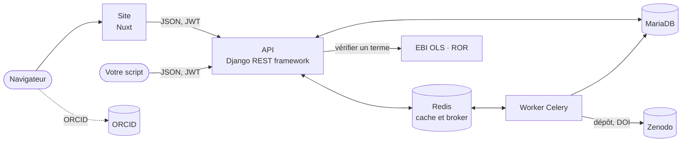

# Documentation développeur

mouseTube est fait d'une **API** (ce dépôt, Django REST framework) et d'un **site** (Nuxt, dans le dépôt
[mousetube_frontend](https://github.com/mouseTube/mousetube_frontend)). Tout ce que fait le site passe par
l'API : l'API est le produit, vous pouvez construire dessus.

## Quoi lire

-   :material-database-outline: **[Schéma de la base](schema.md)**

    ---

    Chaque table et chaque champ, dessinés et décrits, avec la façon dont les tables sont liées.

-   :material-shield-lock-outline: **[Droits et statuts](rights.md)**

    ---

    Qui peut lire, modifier, supprimer et publier chaque objet, selon son statut. La référence.

-   :material-api: **[API REST](api/index.md)**

    ---

    Authentification, conventions et [recettes par but](api/recipes.md) avec des exemples.

-   :material-language-python: **[Référence Python](python/index.md)**

    ---

    Les fonctions que partagent les vues, l'admin et les tâches, d'après leurs docstrings.

## Comment tout s'assemble

- **API** : les modèles, les serializers, les vues et l'admin Django. La lecture est ouverte ; l'écriture demande un
  JWT.
- **Worker Celery** : tout ce qui est lent ou externe : lire et envoyer des fichiers, déposer dans Zenodo, mettre à
  jour une notice publiée, vérifier les liens de téléchargement. Il ne recharge pas son code : **redémarrez-le
  après un déploiement**.
- **Redis** : le cache (limites de débit, progression, compteur de téléchargements) et la file du worker.
- **MariaDB** : les données. Les fichiers eux-mêmes vivent dans un dépôt (Zenodo) ; l'API garde leur description.
- **Vocabulaires** : un terme d'ontologie est vérifié à sa source (EBI OLS, ROR) avant d'être stocké.

## Le code, en un tableau

| Où | Quoi |
|---|---|
| `mousetube_api/models.py` | Les tables. Lisez-les dans le [schéma](schema.md). |
| `mousetube_api/serializers.py` | Ce qui entre et sort, et les contrôles (modération des fiches, droits d'une session). |
| `mousetube_api/views.py` | Les routes et qui peut les utiliser. |
| `mousetube_api/urls.py` | Les routes. |
| `mousetube_api/admin.py` | L'admin Django : modération, tableau de bord. |
| `mousetube_api/review.py` | Les données de la page Review du site. |
| `mousetube_api/tasks.py` | Les tâches Celery. |
| `mousetube_api/utils/` | Les fonctions utilitaires : [référence Python](python/index.md). |
| `mousetube_api/management/commands/` | `normalize_data`, `link_ontology_terms`, `import_dataset_metadata`, `merge_imported_duplicates`, `check_dead_links`, `import_usv_detections`… |
| `mousetube_api/tests/` | Les tests. |

## Lancer et exploiter

- [README](https://github.com/mouseTube/mousetube_API#readme) : installer et lancer avec Docker.
- [Configuration](configuration.md) : chaque variable d'environnement.
- [Mettre à jour un déploiement](deployment.md) : conteneurs, Celery, migrations, mises à niveau des données.
- Fonctionnalités : [Demandes de compte](accounts.md) · [Modération](moderation.md) ·
  [Jeux de données](datasets.md) · [Sessions publiées et versions](publication.md) · [Vocabulaires](ontologies.md) ·
  [Détections d'USV](usv-detections.md) · [Vérification des liens](link-check.md)

## Contribuer

Voir [Contribuer](contributing.md) : les tests, le style, les migrations et comment écrire ces pages.
