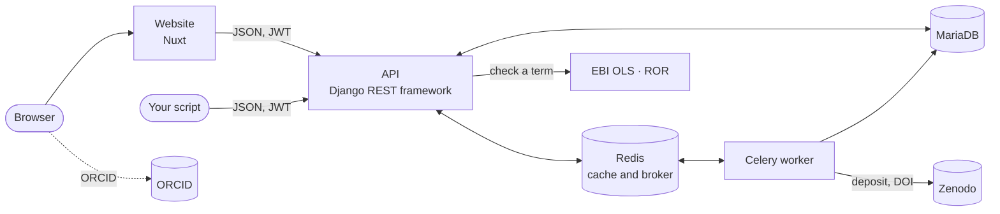

# Developer documentation

mouseTube is made of an **API** (this repository, Django REST framework) and a **website** (Nuxt, in the
[mousetube_frontend](https://github.com/mouseTube/mousetube_frontend) repository). Everything the website does,
it does through the API, so the API is the product: you can build on it.

## What to read

-   :material-database-outline: **[Database schema](schema.md)**

    ---

    Every table and field, drawn and described, with how the tables link.

-   :material-shield-lock-outline: **[Rights and statuses](rights.md)**

    ---

    Who may read, change, delete and publish each object, according to its status. The reference.

-   :material-api: **[REST API](api/index.md)**

    ---

    Authentication, conventions and [recipes by goal](api/recipes.md) with examples.

-   :material-language-python: **[Python reference](python/index.md)**

    ---

    The helpers the views, the admin and the tasks share, from their docstrings.

## How it fits together

- **API**: the models, the serializers, the views and the Django admin. Reads are open; writes need a JWT.
- **Celery worker**: everything slow or external: reading and uploading files, depositing in Zenodo, updating a
  published record, checking the download links. It does not reload its code: **restart it after a deployment**.
- **Redis**: the cache (rate limits, progress, download counter, the files of the Zenodo records, the places of the zip downloads) and the queue of the worker.
- **MariaDB**: the data. The files themselves live in a repository (Zenodo); the API keeps their description.
- **Vocabularies**: a term of an ontology is checked at its source (EBI OLS, ROR) before it is stored.

## The code, in one table

| Where | What |
|---|---|
| `mousetube_api/models.py` | The tables. Read them in the [schema](schema.md). |
| `mousetube_api/serializers.py` | What goes in and out, and the checks (moderation of entries, rights of a session). |
| `mousetube_api/views.py` | The routes and who may use them. |
| `mousetube_api/urls.py` | The routes. |
| `mousetube_api/admin.py` | The Django admin: moderation, dashboard. |
| `mousetube_api/review.py` | The data of the review page of the website. |
| `mousetube_api/tasks.py` | The Celery tasks. |
| `mousetube_api/utils/` | The helpers: [Python reference](python/index.md). |
| `mousetube_api/management/commands/` | `normalize_data`, `link_ontology_terms`, `import_dataset_metadata`, `merge_imported_duplicates`, `check_dead_links`, `import_usv_detections`… |
| `mousetube_api/tests/` | The tests. |

## Run and operate it

- [README](https://github.com/mouseTube/mousetube_API#readme): install and run with Docker.
- [Configuration](configuration.md): every environment variable.
- [Updating a deployment](deployment.md): containers, Celery, migrations, data upgrades.
- Features: [Account requests](accounts.md) · [Moderation](moderation.md) ·
  [Datasets](datasets.md) · [Published sessions and versions](publication.md) · [Vocabularies](ontologies.md) ·
  [USV detections](usv-detections.md) · [Checking the links](link-check.md)

## Contribute

See [Contributing](contributing.md): the tests, the style, the migrations and how to write these pages.
