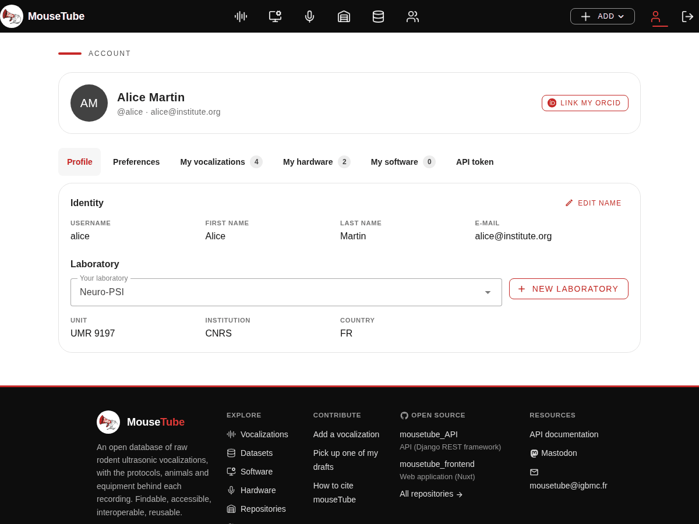

# Votre compte

Ouvrez l'icône de personne dans la barre du haut pour accéder à votre compte.

<figure markdown>
  
  <figcaption>Votre compte, avec le nombre de vos éléments sur chaque onglet.</figcaption>
</figure>

| Onglet | À quoi il sert |
|---|---|
| **Profile** | Votre nom, votre laboratoire (choisissez-en un, ou créez-le) et votre ORCID. **Link my ORCID** relie votre ORCID iD, **Unlink ORCID** le retire. Une section **Activity** donne des chiffres sur votre compte. |
| **Preferences** | Montrer votre e-mail à côté de vos enregistrements (désactivé par défaut), l'affichage des listes (cartes ou tableau), les e-mails que vous recevez, votre mot de passe, vos connexions, une copie de vos données et la suppression de votre compte. |
| **My vocalizations** | Vos sessions par état, avec les actions qui conviennent à chacune. Voir [Partage et validation](share.md). |
| **My hardware**, **My software** | Le matériel et les logiciels que vous avez créés, avec leur état (brouillon, en attente, validé). |
| **API token** | Une clé personnelle pour des scripts. Voir ci-dessous. |

## Changer son mot de passe

Sur la page de votre compte, dans l'onglet **Preferences**, la section **Password** le change : saisissez votre **mot de passe
actuel**, puis le nouveau deux fois. Le nouveau mot de passe suit les règles du formulaire d'inscription : au moins 8
caractères, pas uniquement des chiffres, pas un mot de passe courant ; une barre indique sa force. Il ne demande pas de mail. Si vous l'avez
**oublié**, utilisez *Forgot your password?* sur la page de connexion : vous recevez un lien par e-mail.

## Délier votre ORCID

À côté de votre ORCID iD en haut de la page, **Unlink ORCID** le retire de votre compte après que vous avez saisi votre
**mot de passe**. Vous ne pouvez plus vous connecter avec ORCID (votre mot de passe fonctionne toujours), et vous pouvez
relier un ORCID iD plus tard. L'iD est alors libre : un autre compte peut le relier.

## Votre activité

Dans l'onglet **Profile**, la section **Activity** indique depuis quand vous êtes membre, votre dernière connexion,
combien de fichiers vous avez ajoutés et combien de fois ils ont été **téléchargés** (un visiteur compte une fois par
fichier et par heure).

## Les e-mails que vous recevez

Dans l'onglet **Preferences**, la section **Notifications** permet de choisir deux sortes d'e-mails : quand un
administrateur **valide ou renvoie** ce que vous avez soumis, et quand la **publication** d'une session sur un dépôt est
terminée ou échoue. Les deux sont actifs par défaut. Les e-mails sur la sécurité de votre compte (mot de passe, adresse
e-mail) et la réponse à une demande de compte ne peuvent pas être désactivés.

## Télécharger vos données

Dans l'onglet **Preferences**, la section **My data** a un bouton **Download my data** : un fichier JSON avec votre
compte et tout ce que vous avez ajouté (sessions, fichiers, matériel, logiciels, protocoles, favoris...). Il ne contient
ni votre mot de passe ni les données des autres utilisateurs. Vous pouvez le demander une fois par minute.

## Changer son adresse e-mail

Sur la page de votre compte, dans l'onglet **Profile**, **Change e-mail** à côté de votre adresse ouvre un formulaire :
saisissez la nouvelle adresse (une adresse **institutionnelle**, comme à l'inscription) et votre **mot de passe
actuel**. Un lien est envoyé à la **nouvelle** adresse, valable 24 heures. Ouvrez-le **en étant connecté** à mouseTube
avec votre compte : l'adresse change alors, et pas avant. Votre ancienne adresse reçoit un message quand vous le
demandez et quand elle change, pour que vous sachiez si quelqu'un d'autre l'a fait. Le site ne dit jamais si une adresse
est déjà utilisée par un autre compte : si vous ne recevez rien, vérifiez l'orthographe et les courriers indésirables,
ou utilisez une autre adresse. Un nouveau mot de passe annule un lien pas encore utilisé.

## Se déconnecter de tous les appareils

Dans l'onglet **Preferences**, la section **Sessions** a un bouton **Log out of all devices** : tous les appareils où vous
êtes connecté, celui-ci compris, sont déconnectés, et vous vous reconnectez. Utilisez-le si vous avez perdu un téléphone
ou utilisé un ordinateur partagé. Changer votre mot de passe fait la même chose sur vos autres appareils.

## Supprimer votre compte

Dans l'onglet **Preferences**, la section **Delete my account** ouvre un mail vers `mousetube@igbmc.fr`, déjà rédigé
avec votre identifiant et l'adresse de votre compte. Envoyez-le depuis cette adresse. Un administrateur supprime le
compte et répond sous un mois. Votre profil et votre connexion sont supprimés ; les enregistrements et descriptions que
vous avez ajoutés restent sur mouseTube, sans lien avec votre compte, et ce qui a été publié sur Zenodo y reste public.

## Favoris

Marquez des protocoles, du matériel, des logiciels, des profils d'animaux, des souches, des laboratoires, des
références ou des contacts comme **favoris** : ils passent en premier dans les listes où vous choisissez. Les
favoris sont personnels.

## Le jeton d'API

L'onglet **API token** donne un **jeton d'accès** personnel : il permet à un programme d'agir comme **vous** sur
l'API de mouseTube. Il est réservé aux développeurs ; voir l'[API REST](../dev/api/index.md).

!!! danger "Gardez-le secret"
    Quiconque a votre jeton peut agir en votre nom. Ne le mettez jamais dans du code que d'autres peuvent lire. Il
    cesse de fonctionner au bout d'une heure, et vous pouvez en obtenir un nouveau.
