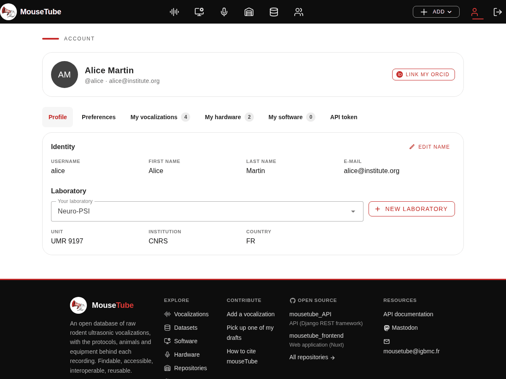

# Your account

Open the person icon in the top bar to reach your account.

<figure markdown>
  
  <figcaption>Your account, with the number of your own items on each tab.</figcaption>
</figure>

| Tab | What it is for |
|---|---|
| **Profile** | Your name, your laboratory (choose one, or create it) and your ORCID. **Link my ORCID** connects your ORCID iD, **Unlink ORCID** removes it. An **Activity** section shows figures about your account. |
| **Preferences** | Show your e-mail next to your recordings (off by default), the display of the lists (cards or table), the e-mails you receive, your password, your sessions, a copy of your data and the deletion of your account. |
| **My vocalizations** | Your sessions by state, with the actions that suit each one. See [Share and validation](share.md). |
| **My hardware**, **My software** | The equipment and software you created, with their state (draft, waiting, validated). |
| **API token** | A personal key for scripts. See below. |

## Change your password

On your account page, in the **Preferences** tab, the **Password** section changes it: type your **current password**, then
the new one twice. The new password follows the rules of the registration form: at least 8 characters, not only digits,
not a common password; a bar shows how strong it is. It does not need an e-mail. If you **forgot** it, use *Forgot your password?* on the sign-in
page: you receive a link by e-mail.

## Unlink your ORCID

Next to your ORCID iD at the top of the page, **Unlink ORCID** removes it from your account after you type your
**password**. You can no longer sign in with ORCID (your password still works), and you can link an ORCID iD again later.
The iD is then free: another account can link it.

## Your activity

In the **Profile** tab, the **Activity** section shows since when you are a member, your last sign-in, how many files
you added and how many times they were **downloaded** (a visitor counts once per file and hour).

## The e-mails you receive

In the **Preferences** tab, the section **Notifications** lets you choose two kinds of e-mail: when an administrator
**validates or sends back** what you submitted, and when the **publication** of a session on a repository is done or
fails. Both are on by default. The e-mails about the security of your account (password, e-mail address) and the answer
to an account request cannot be turned off.

## Download your data

In the **Preferences** tab, the section **My data** has a button **Download my data**: a JSON file with your account
and everything you added (sessions, files, hardware, software, protocols, favorites...). It does not contain your password
or the data of other users. You can ask for it once a minute.

## Change your e-mail address

On your account page, in the **Profile** tab, **Change e-mail** next to your address opens a form: type the new
address (an **institutional** one, like at the registration) and your **current password**. A link is sent to the **new**
address, valid 24 hours. Open it **while signed in** to mouseTube with your account: the address changes then, and
not before. Your old address receives a message when you ask and when it changes, so you know if someone else did.
The site never says whether an address is already used by another account: if you receive nothing, check the spelling
and the spam folder, or use another address. A new password cancels a link not yet used.

## Log out of all devices

In the **Preferences** tab, the section **Sessions** has a button **Log out of all devices**: every device where you
are signed in, this one included, is signed out, and you sign in again. Use it if you lost a phone or used a shared
computer. Changing your password does the same on your other devices.

## Delete your account

In the **Preferences** tab, the section **Delete my account** opens an e-mail to `mousetube@igbmc.fr`, already written
with your username and the address of your account. Send it from that address. An administrator deletes the account
and answers within one month. Your profile and your sign-in are removed; the recordings and descriptions you added
stay on mouseTube, no longer linked to your account, and what was published on Zenodo stays public there.

## Favorites

Mark protocols, hardware, software, animal profiles, strains, laboratories, references or contacts as
**favorites**: they come first in the lists you pick from. Favorites are personal.

## The API token

The **API token** tab gives a personal **access token**: it lets a program act as **you** on the mouseTube API.
It is for developers; see the [REST API](../dev/api/index.md).

!!! danger "Keep it secret"
    Anyone who has your token can act on your behalf. Never put it in code others can read. It stops working
    after an hour, and you can get a new one.
