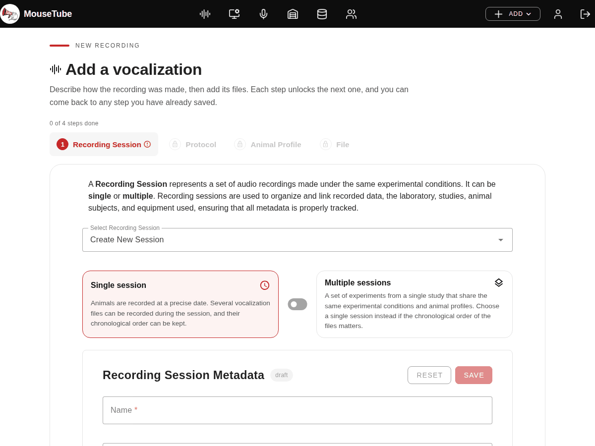
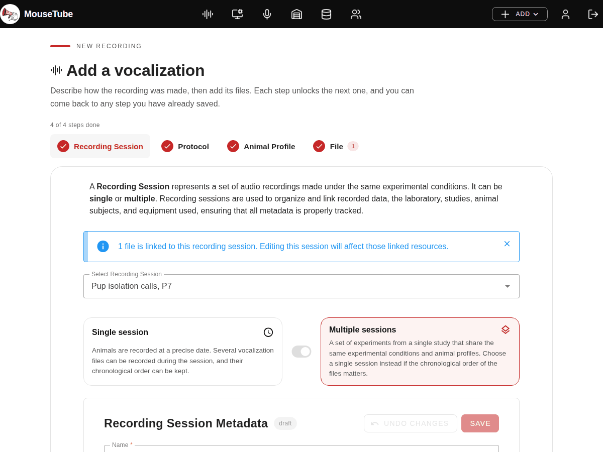
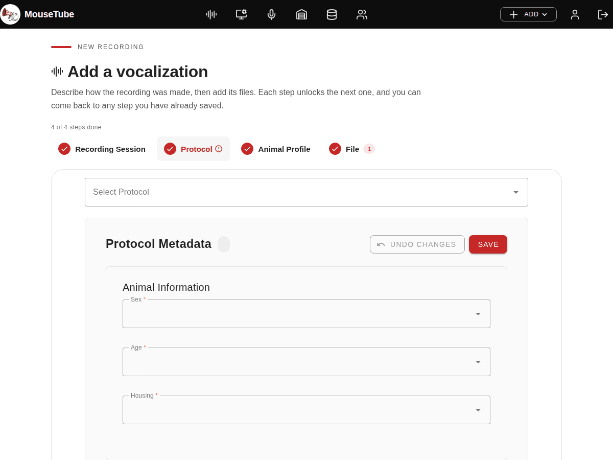
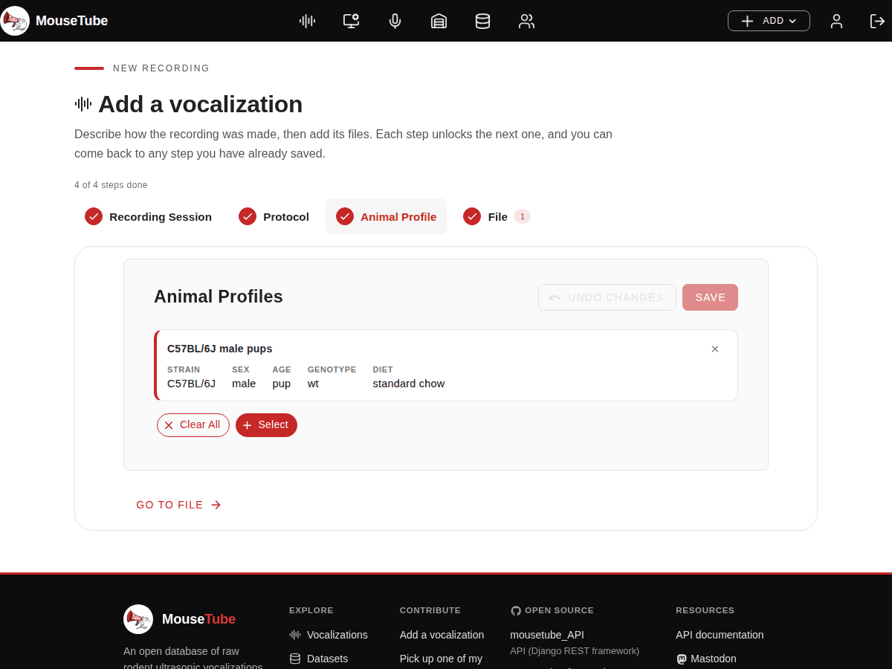
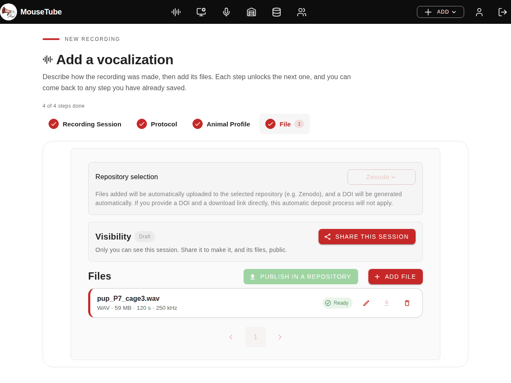

# Ajouter une vocalisation

**Add → Vocalization** dans la barre du haut (ou **New vocalization** dans votre compte) ouvre un formulaire en
**quatre étapes**. Chaque étape débloque la suivante, et vous pouvez revenir à toute étape déjà enregistrée.
L'adresse de la page retient votre session et votre étape : la recharger vous ramène au même endroit.

<figure markdown>
  
  <figcaption>Les quatre étapes sont les onglets du haut. Une coche veut dire que l'étape est enregistrée.</figcaption>
</figure>

!!! info "Il faut un compte"
    Voir [Créer un compte](getting-started.md). Tout ce que vous créez est **privé** (un *brouillon*) tant que vous
    ne le partagez pas.

## 1. La session d'enregistrement

Une **session d'enregistrement** est un ensemble d'enregistrements faits dans les mêmes conditions
expérimentales. Choisissez :

- **Single session** : les animaux sont enregistrés à une date précise et l'ordre des fichiers compte ;
- **Multiple sessions** : un ensemble d'expériences d'une même étude qui partagent les mêmes conditions et les
  mêmes animaux.

<figure markdown>
  
  <figcaption>L'étape de la session. Le nom est unique parmi vos sessions.</figcaption>
</figure>

Remplissez ensuite le **nom**, une **description**, le **laboratoire**, vos **études**, la **température**, le
**matériel** (logiciel, carte son, microphone, haut-parleur, amplificateur) et vos **références**. Choisissez
des fiches existantes dans les listes. S'il manque quelque chose, créez-le depuis la liste ; ce sera un brouillon
jusqu'à sa validation.

- Vos **études sont privées** : personne d'autre que vous ne les voit ni ne les choisit.
- **Undo changes** ramène la dernière version enregistrée de l'étape.

## 2. Le protocole

Le protocole décrit **comment** l'enregistrement a été organisé : sexe et âge des animaux, hébergement, nombre
d'animaux, durée, type de cage, litière et cycle de lumière. Choisissez-en un dans le tableau des protocoles
existants, ou créez-le.

<figure markdown>
  
  <figcaption>Une fois choisi, le protocole est dit par des étiquettes sous le sélecteur.</figcaption>
</figure>

Un protocole n'a **aucun texte libre** : son nom est un code construit à partir de ses champs (par exemple
`2MPG_S_UCBD`), si bien que deux personnes qui décrivent le même dispositif obtiennent le même protocole.

## 3. Le profil d'animaux

Le profil décrit **quels animaux** : souche, sexe, âge, génotype, traitement et régime. Choisissez des profils
existants ou créez-en un ; vous pouvez en ajouter plusieurs à une session. Ceux qui sont choisis sont listés
sous forme de cartes avec leurs étiquettes et leurs valeurs.

<figure markdown>
  
  <figcaption>Les profils choisis pour la session.</figcaption>
</figure>

Quand vous tapez la **souche**, le **sexe**, l'**âge**, le **traitement** ou le **régime**, mouseTube propose le
terme d'un vocabulaire de référence (une *ontologie* : par exemple EFO pour les souches de souris, la Rat Strain
Ontology pour les rats). Choisissez le terme pour que vos données soient comprises par toutes les bases. Une souche
choisie dans l'ontologie est **validée d'office**, et il n'y a qu'une fiche par terme.

## 4. Les fichiers

Ajoutez les fichiers d'enregistrement. Le sélecteur de fichier vient en premier : mouseTube lit le **nom, la
taille, le format et l'en-tête WAV** et remplit les autres champs pour vous.

<figure markdown>
  
  <figcaption>L'étape des fichiers : où vont les fichiers, qui voit la session, et les fichiers.</figcaption>
</figure>

Il y a deux façons d'ajouter un fichier :

- **Laisser mouseTube le déposer.** Le fichier est envoyé au dépôt choisi (Zenodo) et reçoit un **DOI**
  automatiquement. Une barre de progression montre l'envoi, et une erreur est écrite en mots simples.
- **Donner un lien et un DOI.** Si votre fichier a déjà un DOI et un lien de téléchargement (il est déjà dans un
  dépôt), mouseTube les enregistre seulement et ne dépose rien.

Vous pouvez aussi joindre à un fichier les **résultats d'outils de détection** (USVSEG, DeepSqueak et autres), et
choisir de les envoyer au dépôt avec l'enregistrement.

## Et ensuite ?

Une session est un brouillon : **vous seul** la voyez. Quand elle est complète, [partagez-la](share.md).
