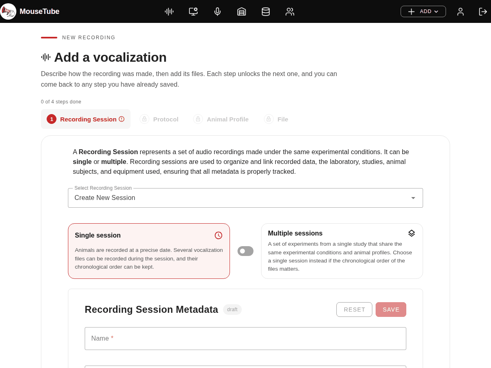
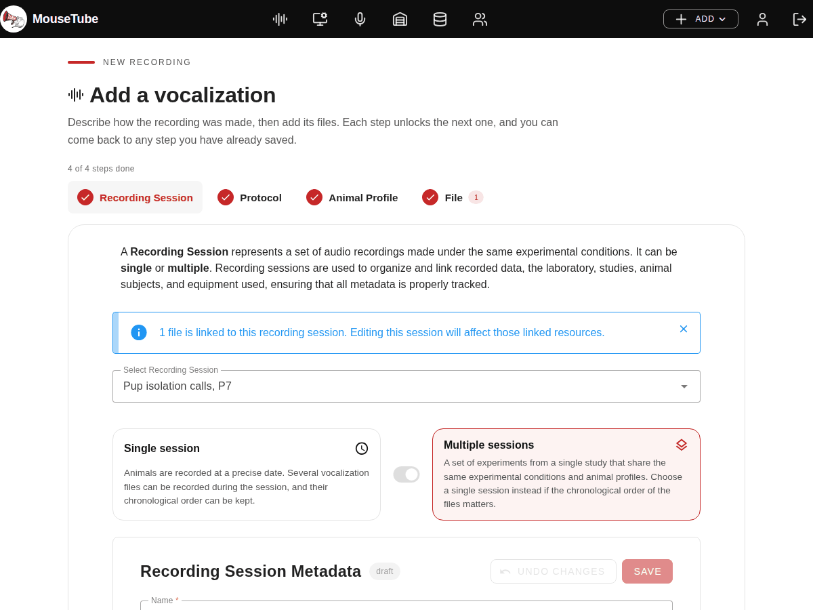
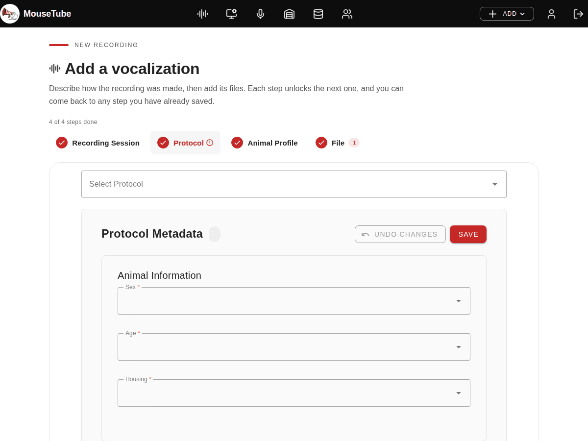
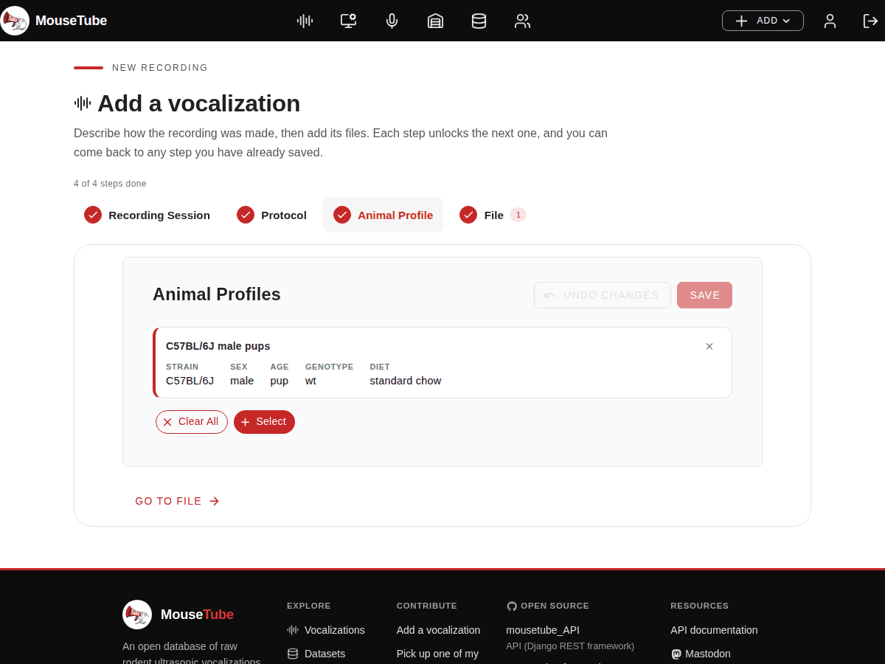
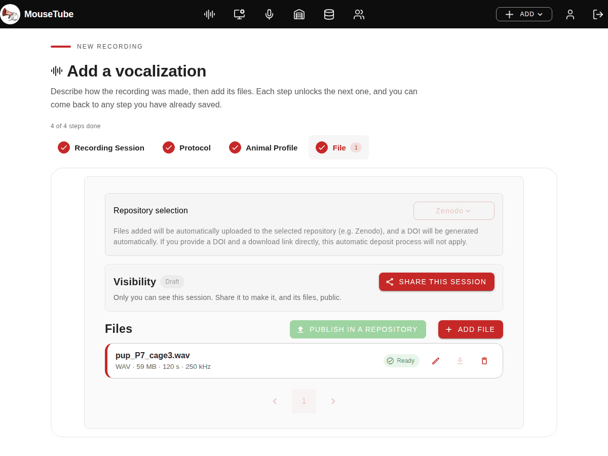

# Add a vocalization

**Add → Vocalization** in the top bar (or **New vocalization** in your account) opens a form in **four steps**.
Each step unlocks the next one, and you can come back to any step you have already saved. The address of the
page remembers your session and your step: reloading it brings you back to the same place.

<figure markdown>
  
  <figcaption>The four steps are the tabs at the top. A check mark means the step is saved.</figcaption>
</figure>

!!! info "You need an account"
    See [Create an account](getting-started.md). Everything you create is **private to you** (a *draft*) until
    you share it.

## 1. The recording session

A **recording session** is a set of recordings made under the same experimental conditions. Choose:

- **Single session**: the animals are recorded at a precise date and the order of the files matters;
- **Multiple sessions**: a set of experiments of a single study that share the same conditions and animals.

<figure markdown>
  
  <figcaption>The session step. The name is unique among your sessions.</figcaption>
</figure>

Then fill the **name**, a **description**, the **laboratory**, your **studies**, the **temperature**, the
**equipment** (software, sound card, microphone, speaker, amplifier) and your **references**. Pick existing
entries from the lists. If something is missing, create it from the list; it stays a draft until validated.

- Your **studies are private**: nobody but you sees or picks them.
- **Undo changes** brings back the last saved version of the step.

## 2. The protocol

The protocol describes **how** the recording was set up: sex and age of the animals, housing, number of animals,
duration, type of cage, bedding and light cycle. Choose one in the table of existing protocols, or create it.

<figure markdown>
  
  <figcaption>Once chosen, the protocol is told with labels under the selector.</figcaption>
</figure>

A protocol has **no free text**: its name is a code built from its fields (for example `2MPG_S_UCBD`), so two
people who describe the same set-up get the same protocol.

## 3. The animal profile

The profile describes **which animals**: strain, sex, age, genotype, treatment and diet. Choose existing
profiles or create one; you can add several to a session. The chosen ones are listed as cards with their
labels and values.

<figure markdown>
  
  <figcaption>The profiles chosen for the session.</figcaption>
</figure>

When you type the **strain**, **sex**, **age**, **treatment** or **diet**, mouseTube suggests the term of a
reference vocabulary (an *ontology*: for example EFO for mouse strains, the Rat Strain Ontology for rats). Pick
the term to make your data understood by every database. A strain chosen in the ontology is **validated at
once**, and there is only one entry per term.

## 4. The files

Add the recording files. The file selector comes first: mouseTube reads the **name, size, format and WAV header**
and fills the other fields for you.

<figure markdown>
  
  <figcaption>The file step: where the files go, who sees the session, and the files.</figcaption>
</figure>

There are two ways to add a file:

- **Let mouseTube deposit it.** The file is sent to the selected repository (Zenodo) and receives a **DOI**
  automatically. A progress bar shows the upload, and an error is written in plain words.
- **Give a link and a DOI.** If your file already has a DOI and a download link (it is already on a
  repository), mouseTube only records them and does not deposit anything.

You can also attach the **results of detection tools** (USVSEG, DeepSqueak and others) to a file, and tell
whether to send them to the repository with the recording.

## What next?

A session is a draft: **only you** see it. When it is complete, [share it](share.md).
