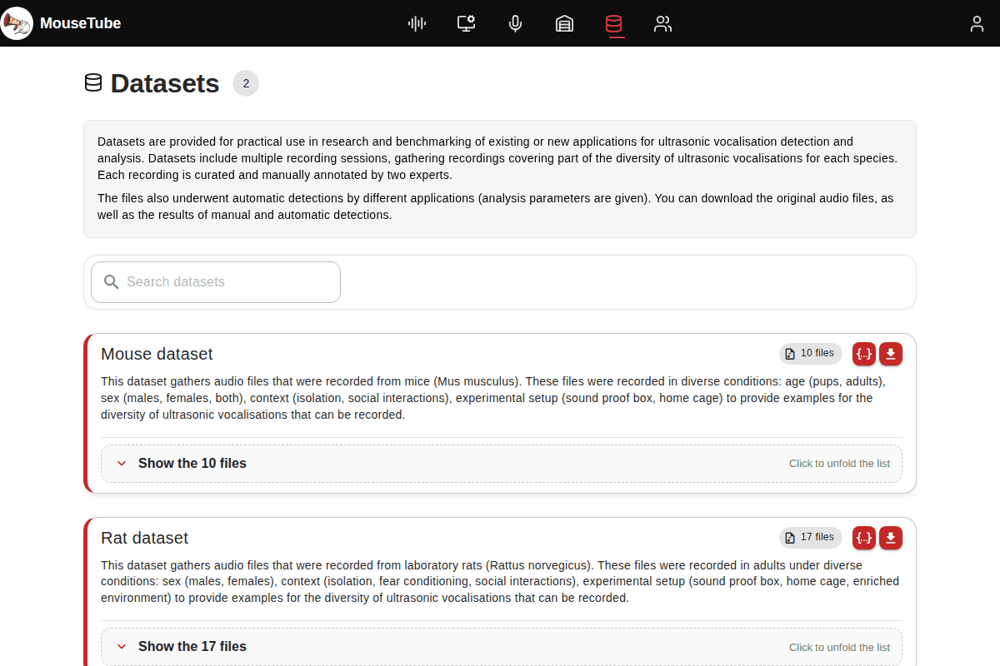
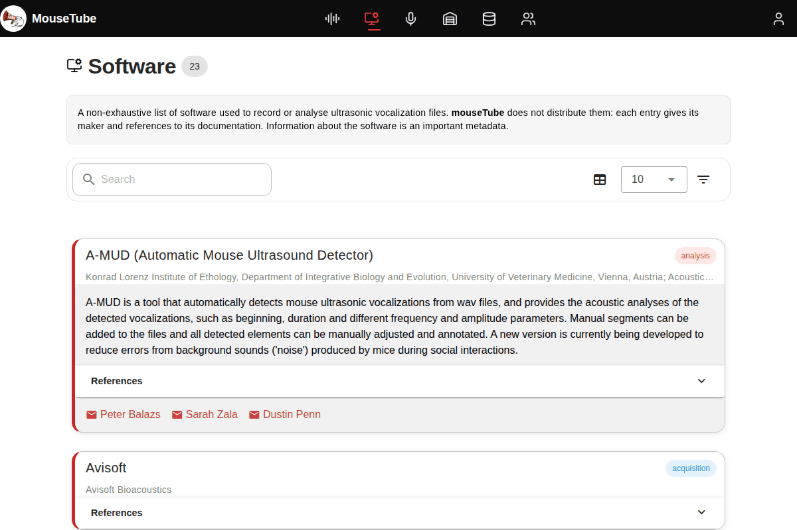
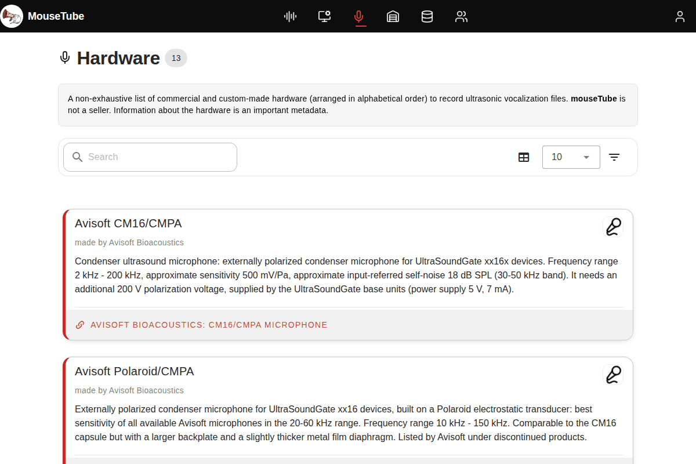
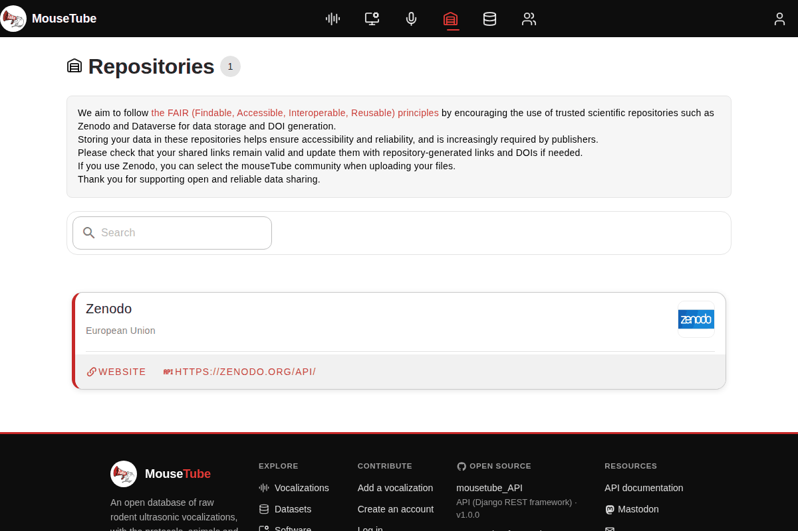

# Jeux de données, logiciels, matériel et dépôts

Ces quatre parties du site sont ouvertes à tous et sont faites pour vous aider à **comprendre et reproduire** les
enregistrements.

## Jeux de données

**Dataset** dans la barre du haut liste des collections choisies de sessions avec leurs métadonnées, construites
par l'équipe de mouseTube (par exemple une avec des enregistrements de souris et une avec des enregistrements de
rats, annotées par des experts et analysées par six algorithmes).

<figure markdown>
  
  <figcaption>Un jeu de données rassemble des sessions. Ouvrez-en un pour voir ses fichiers.</figcaption>
</figure>

- Cherchez par nom de jeu, nom de fichier, DOI ou profil d'animaux.
- Chaque jeu a un lien **metadata JSON** : la même description de chaque session, protocole, animal et matériel,
  prête à être lue par un programme.
- Seules les sessions publiques d'un jeu sont montrées.

## Logiciels

<figure markdown>
  
  <figcaption>Les logiciels utilisés pour enregistrer ou analyser des vocalisations.</figcaption>
</figure>

Une liste non exhaustive des logiciels utilisés pour **enregistrer ou analyser** des vocalisations ultrasoniques.
mouseTube ne les distribue pas : chaque fiche donne son fabricant, son type (**acquisition**, **analyse** ou les
deux), sa documentation et les personnes à contacter. Connaître le logiciel fait partie des métadonnées
importantes d'un enregistrement.

## Matériel

**Hardware** liste les microphones, cartes son, haut-parleurs et amplificateurs utilisés pour réaliser les
enregistrements, avec leur fabricant et leurs références. Utilisez les filtres pour garder un type, les fiches
utilisées par des sessions partagées, ou celles qui ont de la documentation.

<figure markdown>
  
  <figcaption>Le matériel utilisé par les enregistrements.</figcaption>
</figure>

## Dépôts

**Repositories** vous dit où les fichiers sont stockés et comment y accéder. Zenodo est le dépôt par défaut.

<figure markdown>
  
  <figcaption>Où vivent les fichiers.</figcaption>
</figure>

!!! tip "Il manque quelque chose ?"
    Si vous êtes connecté, vous pouvez **ajouter** vous-même des logiciels et du matériel (**Add** dans la barre
    du haut). Ils restent privés tant que vous ne demandez pas de relecture. Voir
    [Partage et validation](share.md).
