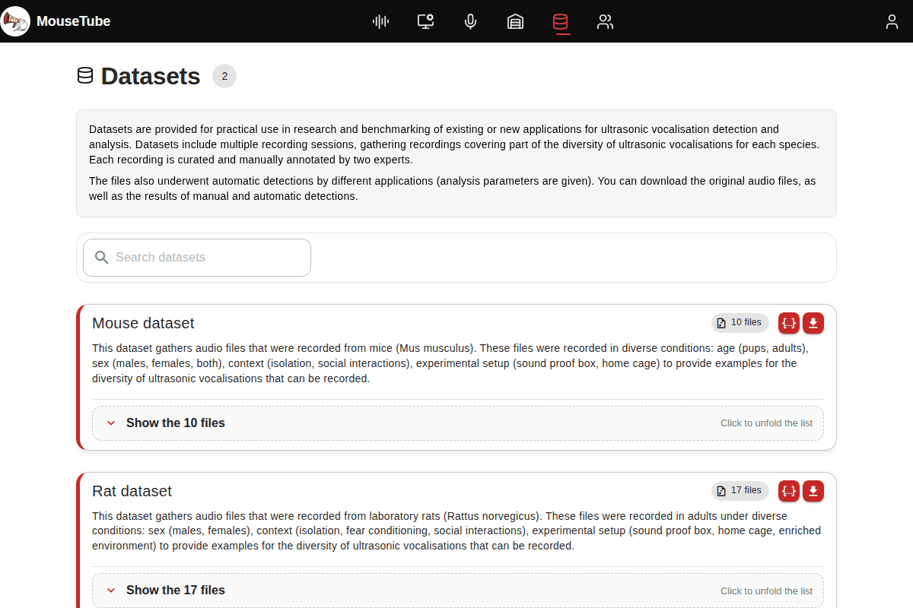
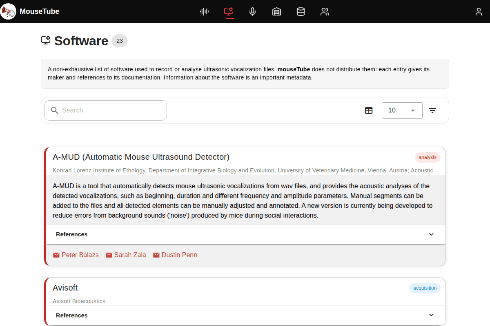
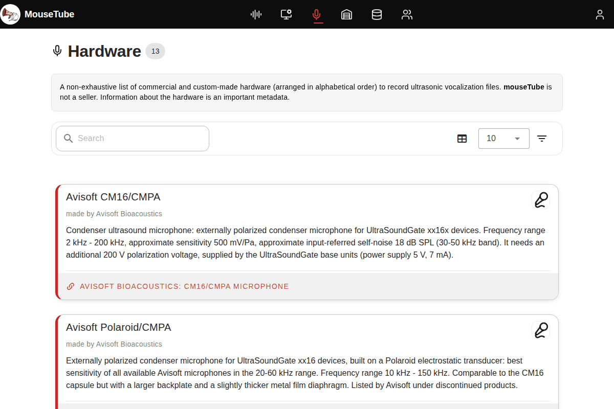
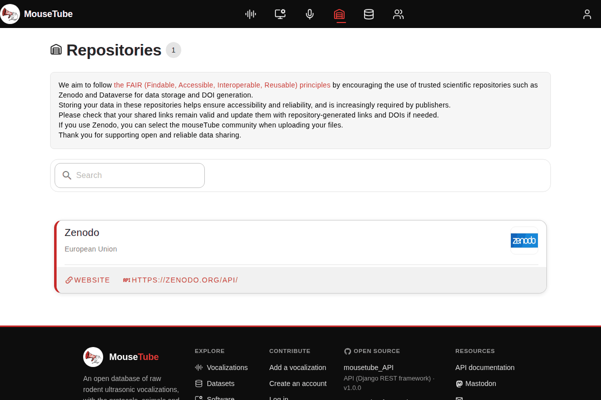

# Datasets, software, hardware and repositories

These four parts of the site are open to everybody and are made to help you **understand and reproduce** the
recordings.

## Datasets

**Dataset** in the top bar lists curated collections of sessions with their metadata, built by the mouseTube
team (for example one with mouse recordings and one with rat recordings, annotated by experts and analysed by
six algorithms).

<figure markdown>
  
  <figcaption>A dataset gathers sessions. Open one to see its files.</figcaption>
</figure>

- Search by dataset name, file name, DOI or animal profile.
- Each dataset has a **metadata JSON** link: the same description of every session, protocol, animal and
  equipment, ready to be read by a program.
- Only the public sessions of a dataset are shown.

## Software

<figure markdown>
  
  <figcaption>The software used to record or analyse vocalizations.</figcaption>
</figure>

A non-exhaustive list of the software used to **record or analyse** ultrasonic vocalizations. mouseTube does
not distribute them: each entry gives its maker, its type (**acquisition**, **analysis** or both), its
documentation and the people to contact. Knowing the software is an important part of the metadata of a
recording.

## Hardware

**Hardware** lists the microphones, sound cards, speakers and amplifiers used to make the recordings, with their
manufacturer and references. Use the filters to keep a type, the entries that are used by shared sessions, or
those that have documentation.

<figure markdown>
  
  <figcaption>The equipment used by the recordings.</figcaption>
</figure>

## Repositories

**Repositories** tells you where the files are stored and how to reach them. Zenodo is the default one.

<figure markdown>
  
  <figcaption>Where the files live.</figcaption>
</figure>

!!! tip "Missing something?"
    If you are signed in you can **add** software and hardware yourself (**Add** in the top bar). It stays
    private to you until you ask for a review. See [Share and validation](share.md).
