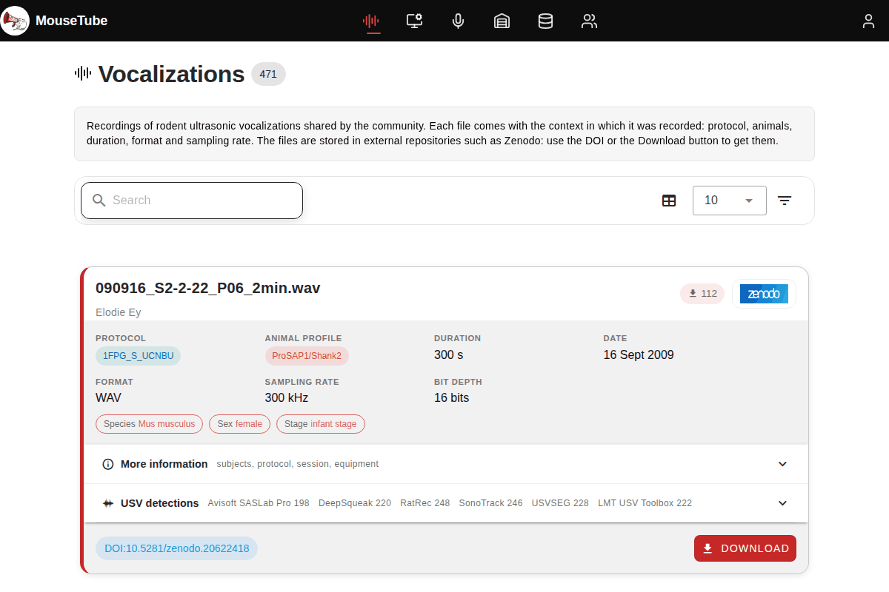
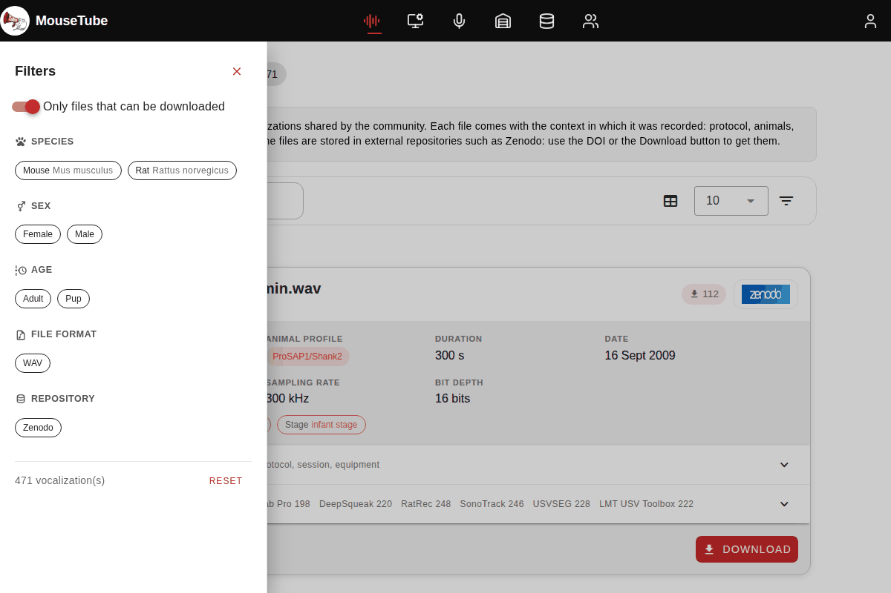
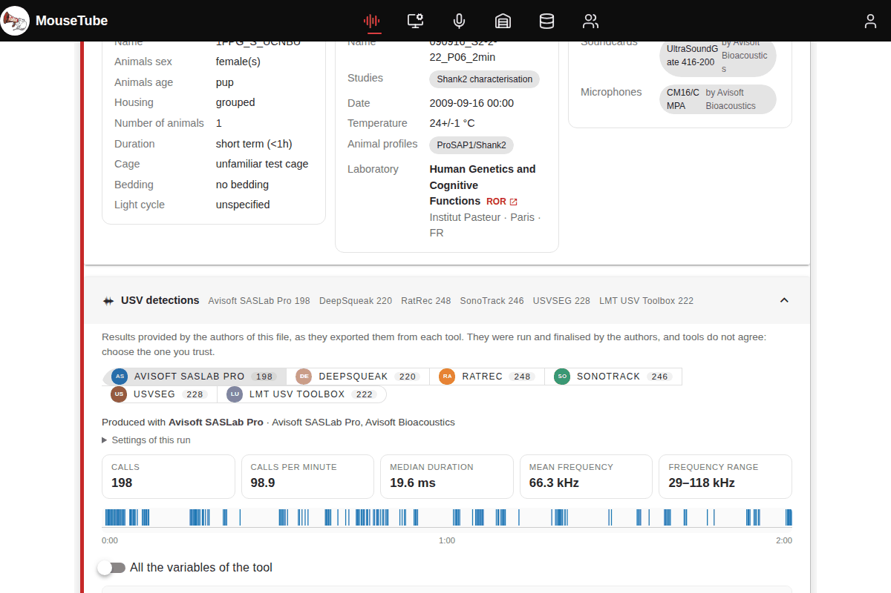

# Trouver et télécharger des enregistrements

Aucun compte n'est nécessaire. Ouvrez **Vocalizations** dans la barre du haut.

<figure markdown>
  
  <figcaption>Une carte par fichier d'enregistrement.</figcaption>
</figure>

## Lire une carte

Chaque carte vous donne, d'un coup d'œil :

- le **nom du fichier** et la personne qui l'a enregistré ;
- le **protocole**, le **profil d'animaux**, la **durée**, la **date**, le **format**, la **fréquence
  d'échantillonnage** et la **profondeur de bits** ;
- des pastilles pour l'espèce, le sexe et le stade d'âge des animaux ;
- le nombre de **téléchargements** et le **dépôt** qui stocke le fichier (par exemple Zenodo) ;
- le **DOI** et un bouton **Download**.

!!! note "Les fichiers ne sont pas stockés sur mouseTube"
    Les enregistrements vivent dans un dépôt comme Zenodo. **Download** ou le DOI vous y mène. mouseTube garde la
    description, le contexte et les liens.

## Télécharger un fichier, un enregistrement ou un jeu de données

- Le bouton **Download** en face du nom d'un fichier télécharge **seulement ce fichier** (son texte au survol le dit).
- Sur la page **Dataset**, dépliez un fichier : la liste de **tous les fichiers de son enregistrement Zenodo**
  apparaît (l'enregistrement, les tableaux des outils de détection, les images) avec leur taille. Le nom ouvre un
  aperçu sur Zenodo et la flèche télécharge ce fichier. Tout le monde peut le faire.
- **Connecté**, vous avez aussi **Download all (zip)** sur l'enregistrement, et sur le jeu de données un menu avec
  **Sound files only** ou **All files** (enregistrements, images et analyses, un dossier par enregistrement). Le zip
  est fabriqué pendant qu'il est envoyé ; un fichier qui n'a pas pu être lu est listé dans `_errors.txt` à l'intérieur.

!!! note "Pourquoi se connecter pour un zip ?"
    Zenodo ne donne plus le zip d'un enregistrement entier aux programmes : mouseTube le fabrique. Il est réservé
    aux utilisateurs connectés pour que les robots ne prennent pas des jeux de données entiers. Les très gros jeux
    de données sont refusés (500 fichiers ou 20 Gio par défaut) : téléchargez leurs fichiers un par un.

## Chercher

Tapez dans la zone de recherche : elle regarde dans les noms des fichiers, des sessions et des animaux, le
protocole, le laboratoire, le matériel et l'auteur. Quand vous tapez plusieurs mots, tous doivent être trouvés
quelque part.

## Filtrer

Ouvrez le bouton **Filters** (les trois traits) à droite de la zone de recherche.

<figure markdown>
  
  <figcaption>Le panneau de filtres. Chaque option ne montre que les valeurs qui existent dans la base.</figcaption>
</figure>

Vous pouvez garder seulement les fichiers téléchargeables et choisir une **espèce**, un **sexe**, un **âge**, un
**format de fichier** ou un **dépôt**. **Reset** efface tout. Le bouton à côté des filtres passe de la liste de
cartes à un tableau.

## Lire tout le contexte

Ouvrez **More information** sur une carte pour voir, en petites sections : les sujets, le protocole, la session,
le laboratoire et le matériel. Si les auteurs ont ajouté des résultats d'outils de détection, **USV detections**
montre les appels trouvés par six outils (USVSEG, DeepSqueak, Avisoft SASLab Pro, SonoTrack, RatRec, LMT USV
Toolbox), avec leurs réglages. Les outils ne s'accordent pas toujours : choisissez celui en qui vous avez confiance.

<figure markdown>
  
  <figcaption>Le contexte d'un fichier, et les appels trouvés par un outil de détection.</figcaption>
</figure>

## Citer ce que vous utilisez

Un fichier qui a un **DOI** est citable : citez le DOI comme pour n'importe quel jeu de données. Pour citer
mouseTube lui-même, voyez **How to cite mouseTube** dans le pied de page.
