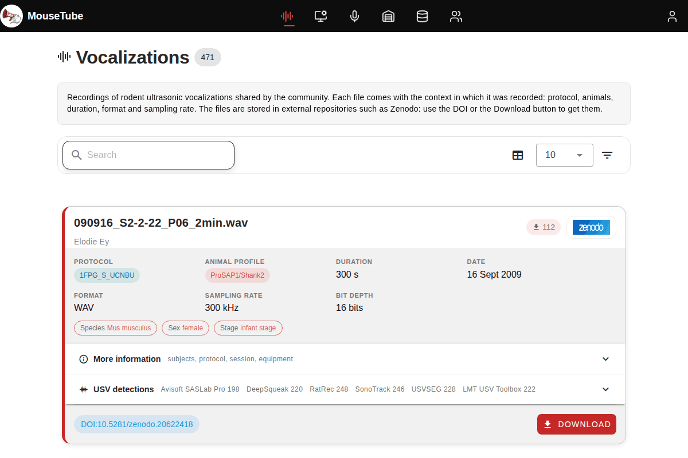
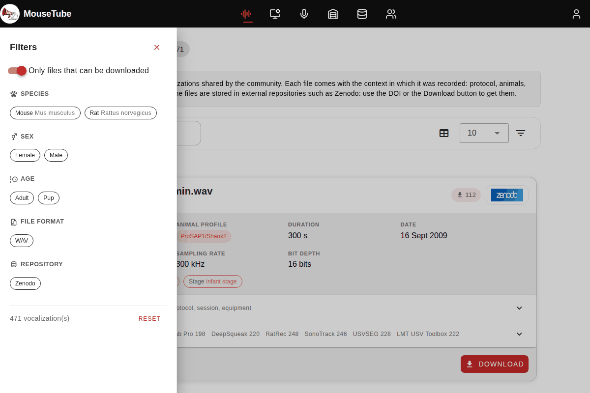
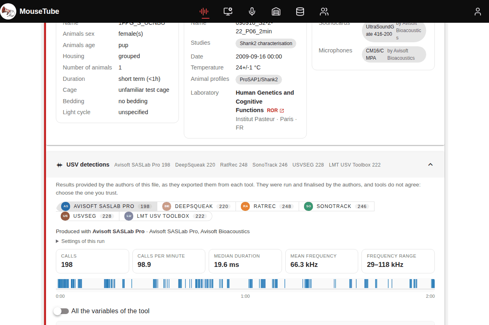

# Find and download recordings

No account is needed. Open **Vocalizations** in the top bar.

<figure markdown>
  
  <figcaption>One card per recording file.</figcaption>
</figure>

## Read a card

Each card gives you, at a glance:

- the **file name** and the person who recorded it;
- the **protocol**, the **animal profile**, the **duration**, the **date**, the **format**, the **sampling rate**
  and the **bit depth**;
- chips for the species, the sex and the age stage of the animals;
- the number of **downloads** and the **repository** that stores the file (for example Zenodo);
- the **DOI** and a **Download** button.

!!! note "The files are not stored on mouseTube"
    The recordings live in a repository such as Zenodo. **Download** or the DOI takes you there. mouseTube
    keeps the description, the context and the links.

## Download a file, a record or a dataset

- The **Download** button in front of the name of a file downloads **only that file** (its hover text says so).
- On the page **Dataset**, unfold a file: the list of **every file of its Zenodo record** appears (the recording, the
  tables of the detection tools, the images) with their sizes. The name opens a preview on Zenodo and the arrow
  downloads that file. Anyone can do this.
- **Signed in**, you also get **Download all (zip)** on the record, and on the dataset a menu with **Sound files
  only** or **All files** (recordings, images and analyses, one folder per record). The zip is made while it is
  sent; a file that could not be read is listed in `_errors.txt` inside it.

!!! note "Why sign in for a zip?"
    Zenodo no longer gives the zip of a whole record to programs, so mouseTube makes it. It is kept for signed-in
    users so that robots do not take whole datasets. Very large datasets are refused (500 files or 20 GiB by
    default): download their files one by one.

## Search

Type in the search box: it looks in the names of the files, sessions and animals, the protocol, the laboratory,
the equipment and the author. Several words must all be found somewhere.

## Filter

Open the **Filters** button (the three lines) at the right of the search box.

<figure markdown>
  
  <figcaption>The filter panel. Each option shows only the values that exist in the database.</figcaption>
</figure>

You can keep only the files that can be downloaded, and choose a **species**, a **sex**, an **age**, a **file
format** or a **repository**. **Reset** clears everything. The switch next to the filters changes the list between
cards and a table.

## Read the whole context

Open **More information** on a card to see, in small sections: the subjects, the protocol, the session, the
laboratory and the equipment. If the authors added results of detection tools, **USV detections** shows the
calls that six tools found (USVSEG, DeepSqueak, Avisoft SASLab Pro, SonoTrack, RatRec, LMT USV Toolbox), with
their settings. The tools do not always agree: choose the one you trust.

<figure markdown>
  
  <figcaption>The context of a file, and the calls found by a detection tool.</figcaption>
</figure>

## Cite what you use

A file with a **DOI** is citable: cite the DOI as for any dataset. To cite mouseTube itself, see **How to cite
mouseTube** in the footer.
