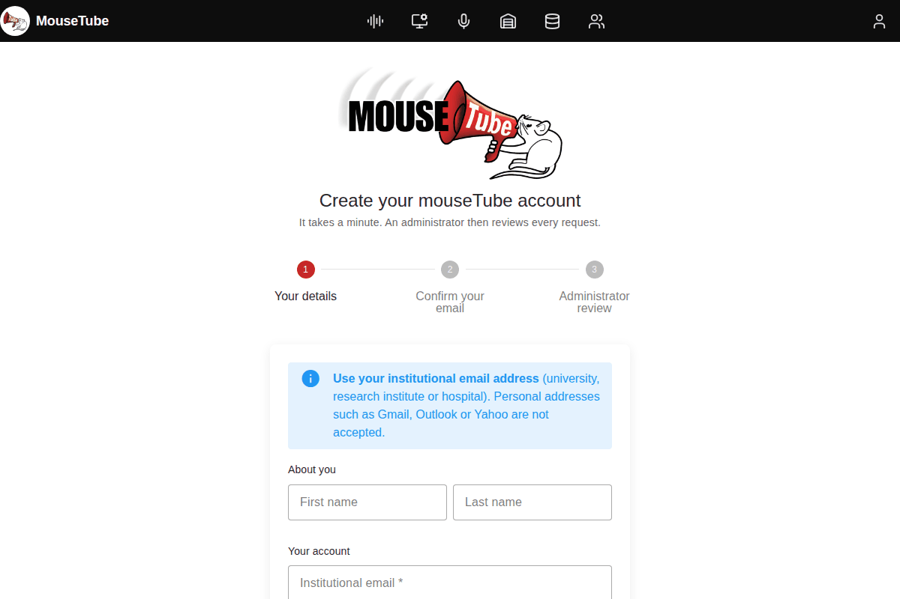
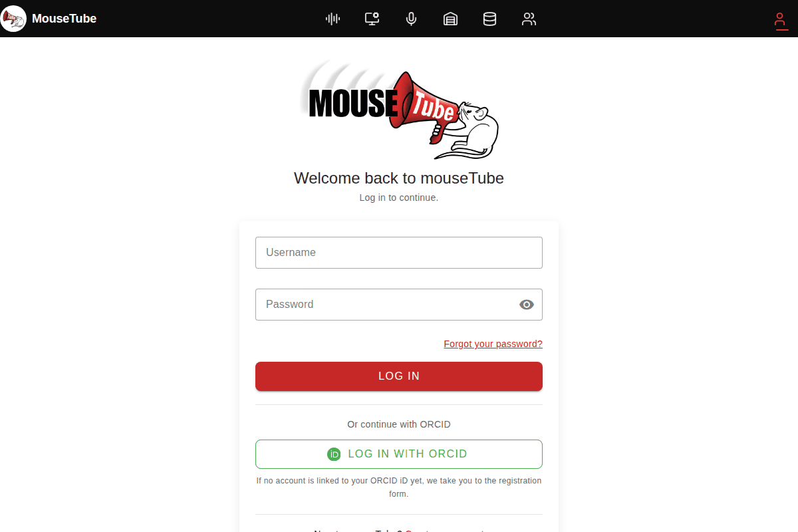

# Créer un compte

Vous pouvez parcourir mouseTube sans compte. Il en faut un pour **ajouter** des enregistrements, du matériel,
des logiciels et des laboratoires, garder des favoris et suivre votre propre travail.

## 1. Remplir le formulaire

Ouvrez **Login** dans la barre du haut, puis **Create an account**.

<figure markdown>
  
  <figcaption>Le formulaire d'inscription. Les trois étapes sont affichées en haut.</figcaption>
</figure>

- Utilisez votre **adresse e-mail institutionnelle** (université, institut de recherche, hôpital). Les adresses
  personnelles comme Gmail, Outlook ou Yahoo ne sont pas acceptées : le formulaire vous le dit dès que vous en
  tapez une.
- Choisissez un nom d'utilisateur et un mot de passe. Vous pouvez ajouter votre **ORCID iD**.

!!! tip "Vous préférez ORCID ?"
    Sur la page de connexion, **Log in with ORCID** vous connecte avec votre compte ORCID. Si aucun compte
    mouseTube n'est encore lié à votre ORCID iD, vous arrivez sur le formulaire d'inscription avec votre nom déjà
    rempli.

## 2. Confirmer votre e-mail

mouseTube vous envoie un message avec un lien. Cliquez dessus. S'il n'arrive pas, regardez dans vos courriers
indésirables, puis utilisez **Resend the email** (vous pouvez le redemander au bout d'une minute).

## 3. Attendre l'administrateur

Un administrateur de mouseTube vérifie chaque demande avant d'activer le compte : cela garde la base entre les
mains de chercheurs. Vous êtes prévenu par e-mail. Si vous essayez de vous connecter avant, la page de connexion
vous dit où en est votre demande (en attente de la confirmation de l'e-mail, ou de la relecture).

## Se connecter

<figure markdown>
  
  <figcaption>La page de connexion.</figcaption>
</figure>

Si vous avez oublié votre mot de passe, **Forgot your password?** vous envoie un lien pour en choisir un nouveau.

!!! info "Votre e-mail reste privé"
    Votre adresse e-mail n'est pas montrée à côté de vos enregistrements, sauf si vous le choisissez dans
    **Account → Preferences**. Votre nom est public : il est affiché avec les enregistrements que vous partagez.
