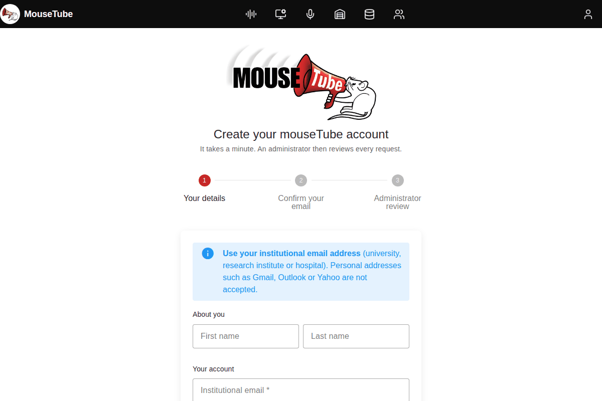
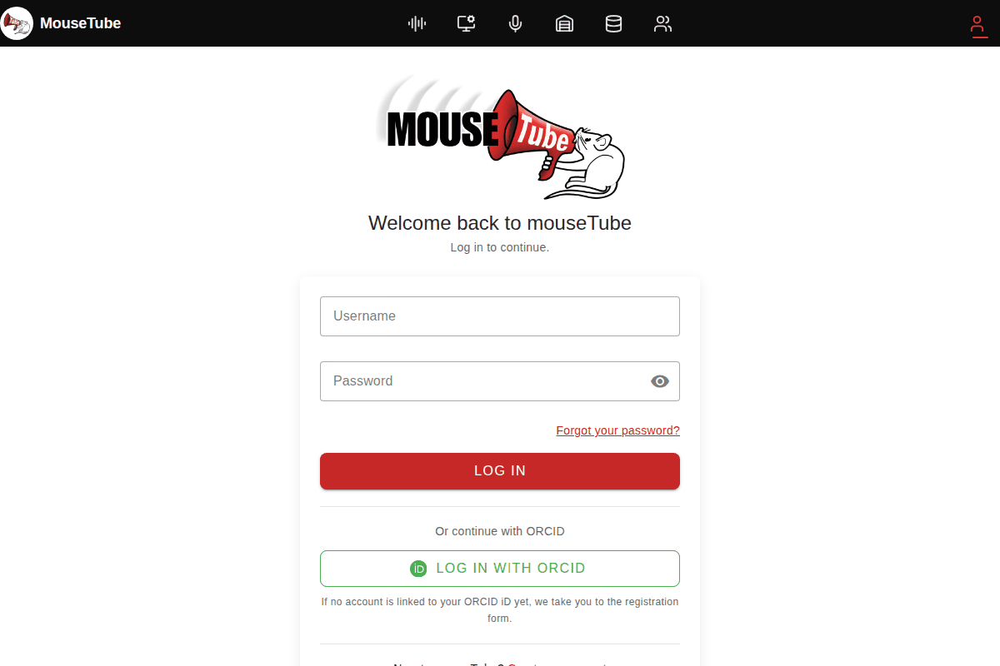

# Create an account

You can browse mouseTube without an account. You need one to **add** recordings, equipment, software and
laboratories, to keep favorites and to follow your own work.

## 1. Fill in the form

Open **Login** in the top bar, then **Create an account**.

<figure markdown>
  
  <figcaption>The registration form. The three steps are shown at the top.</figcaption>
</figure>

- Use your **institutional e-mail address** (university, research institute, hospital). Personal addresses
  such as Gmail, Outlook or Yahoo are not accepted: the form tells you as soon as you type one.
- Choose a username and a password. You may add your **ORCID iD**.

!!! tip "Prefer ORCID?"
    On the login page, **Log in with ORCID** signs you in with your ORCID account. If no mouseTube account is
    linked to your ORCID iD yet, you are taken to the registration form with your name already filled in.

## 2. Confirm your e-mail

mouseTube sends you a message with a link. Click it. If nothing arrives, check your spam folder, then use
**Resend the email** (you can ask again after one minute).

## 3. Wait for the administrator

An administrator of mouseTube checks every request before activating the account: it keeps the database in the
hands of researchers. You are told by e-mail. If you try to sign in before, the login page tells you where your
request stands (waiting for the e-mail confirmation, or for the review).

## Signing in

<figure markdown>
  
  <figcaption>The login page.</figcaption>
</figure>

If you forgot your password, **Forgot your password?** sends you a link to choose a new one.

!!! info "Your e-mail stays private"
    Your e-mail address is not shown next to your recordings unless you choose to, in **Account → Preferences**.
    Your name is public: it is shown with the recordings you share.
