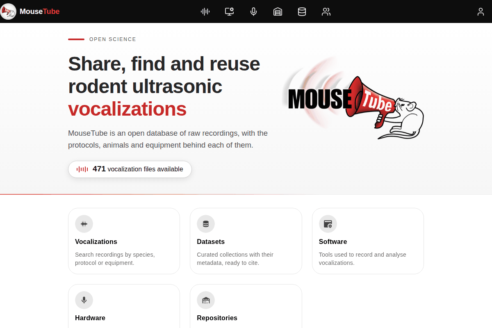

# Bienvenue sur mouseTube

mouseTube est une base ouverte d'**enregistrements bruts de vocalisations ultrasoniques de rongeurs**. Chaque
enregistrement est accompagné de ce qu'il faut pour le comprendre et le réutiliser : le protocole, les animaux,
le matériel et les personnes qui l'ont réalisé.

<figure markdown>
  
  <figcaption>La page d'accueil. La barre du haut mène à toutes les parties du site.</figcaption>
</figure>

!!! info "Le site est en anglais"
    Les noms des boutons et des menus du site sont en anglais. Dans ce guide ils sont écrits tels qu'ils
    apparaissent à l'écran, en gras (par exemple **Share this session**).

## Que voulez-vous faire ?

-   :material-magnify: [**Trouver et télécharger des enregistrements**](find.md)

    ---

    Aucun compte nécessaire. Chercher, filtrer, lire le contexte d'un fichier et le télécharger.

    [:octicons-arrow-right-24: Trouver des enregistrements](find.md)

-   :material-account-plus-outline: [**Créer un compte**](getting-started.md)

    ---

    Nécessaire pour ajouter des enregistrements, du matériel ou des logiciels. Une minute, puis un
    administrateur vérifie la demande.

    [:octicons-arrow-right-24: Pour commencer](getting-started.md)

-   :material-plus-circle-outline: [**Ajouter une vocalisation**](add.md)

    ---

    Quatre étapes : la session, le protocole, les animaux, les fichiers.

    [:octicons-arrow-right-24: Ajouter une vocalisation](add.md)

-   :material-share-variant-outline: [**Partager et publier**](share.md)

    ---

    Rendre une session publique, comprendre la relecture, et obtenir un DOI pour citer vos données.

    [:octicons-arrow-right-24: Partager](share.md) · [Publier](publish.md)

## Le vocabulaire de mouseTube en une minute

| Mot | Ce que cela veut dire |
|---|---|
| **Vocalisation** | Un fichier d'enregistrement, avec son contexte. |
| **Session d'enregistrement** | Un ensemble d'enregistrements faits dans les mêmes conditions. C'est ce que vous partagez et publiez. |
| **Protocole** | Comment l'enregistrement a été organisé : nombre d'animaux, âge, hébergement, durée, cage, litière, lumière. |
| **Profil d'animaux** | Le type d'animaux enregistrés : souche, sexe, âge, génotype, traitement, régime. |
| **Matériel** | Les microphones, cartes son, haut-parleurs, amplificateurs et les logiciels utilisés. |
| **Jeu de données** | Une collection choisie de sessions, construite par l'équipe de mouseTube. |
| **Dépôt** | Où les fichiers sont stockés (Zenodo par défaut). Ils y reçoivent un DOI. |
| **Validé** | Vérifié par un administrateur de mouseTube. Seules les fiches validées sont montrées à tous. |

Voir aussi la [FAQ et le glossaire](faq.md).
