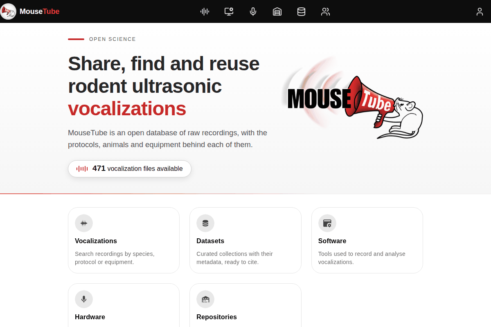

# Welcome to mouseTube

mouseTube is an open database of **raw recordings of rodent ultrasonic vocalizations**. Each recording comes with
what you need to understand and reuse it: the protocol, the animals, the equipment and the people behind it.

<figure markdown>
  
  <figcaption>The home page. The top bar leads to every part of the site.</figcaption>
</figure>

## What do you want to do?

-   :material-magnify: **Find and download recordings**

    ---

    No account needed. Search, filter, read the context of a file and download it.

    [:octicons-arrow-right-24: Find recordings](find.md)

-   :material-account-plus-outline: **Create an account**

    ---

    Needed to add recordings, equipment or software. Takes a minute, then an administrator checks the request.

    [:octicons-arrow-right-24: Getting started](getting-started.md)

-   :material-plus-circle-outline: **Add a vocalization**

    ---

    Four steps: the session, the protocol, the animals, the files.

    [:octicons-arrow-right-24: Add a vocalization](add.md)

-   :material-share-variant-outline: **Share and publish**

    ---

    Make a session public, understand the review, and get a DOI to cite your data.

    [:octicons-arrow-right-24: Share](share.md) · [Publish](publish.md)

## The vocabulary of mouseTube in one minute

| Word | What it means |
|---|---|
| **Vocalization** | A recording file, with its context. |
| **Recording session** | A set of recordings made under the same conditions. It is what you share and publish. |
| **Protocol** | How the recording was set up: number of animals, age, housing, duration, cage, bedding, light. |
| **Animal profile** | The kind of animals recorded: strain, sex, age, genotype, treatment, diet. |
| **Equipment** | The microphones, sound cards, speakers, amplifiers and the software used. |
| **Dataset** | A curated collection of sessions, built by the mouseTube team. |
| **Repository** | Where the files are stored (Zenodo by default). The files get a DOI there. |
| **Validated** | Checked by a mouseTube administrator. Only validated entries are shown to everybody. |

See also the [FAQ and glossary](faq.md).
