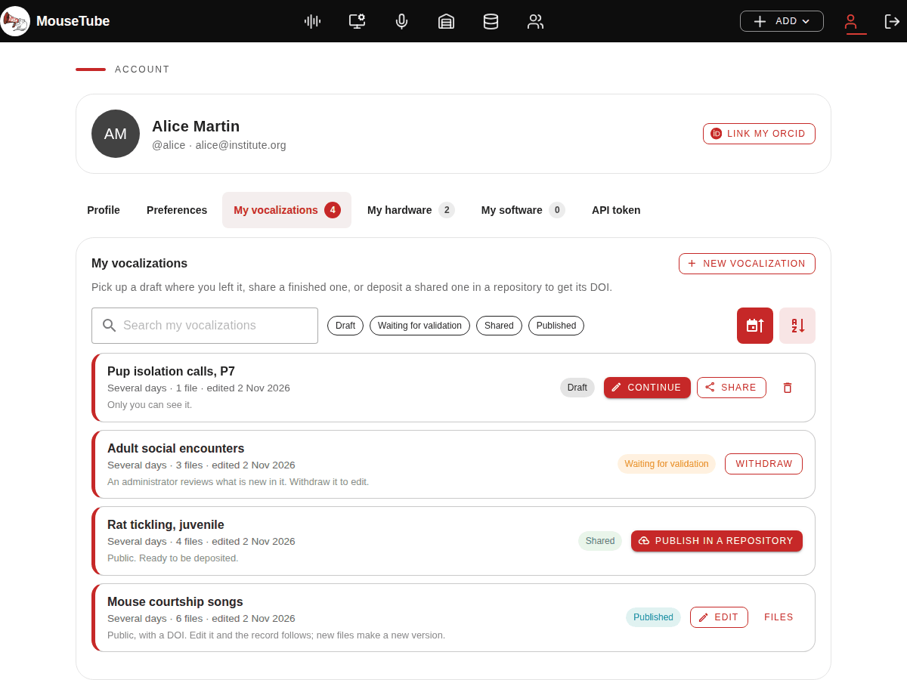
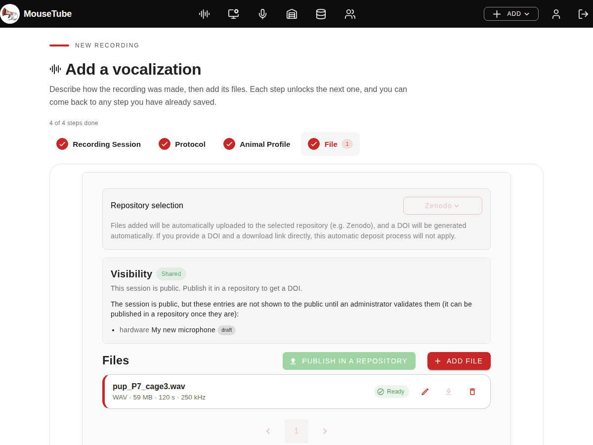

# Partage et validation

Une session commence comme un **brouillon** : vous seul la voyez, avec ses fichiers. La partager la rend, avec ses
fichiers, **publique**.

<figure markdown>
  
  <figcaption>Vos sessions dans <strong>Account → My vocalizations</strong>, chacune dans son état.</figcaption>
</figure>

## Les quatre états d'une session

| État | Qui la voit | Ce que vous pouvez faire |
|---|---|---|
| Draft | Vous seul | Continuer à la modifier, **Share**, la supprimer |
| Waiting for validation | Vous seul (et les administrateurs) | **Withdraw** pour la modifier à nouveau. Vous ne pouvez pas la modifier entre-temps. |
| Shared | Tout le monde | La modifier (elle reste publique), **Publish in a repository** pour obtenir un DOI |
| Published | Tout le monde, avec un DOI | La modifier (sa notice suit), ajouter des fichiers pour une nouvelle version |

## Partager une session

Ouvrez la dernière étape (**File**) et choisissez **Share this session** dans la carte *Visibility*, ou utilisez
**Share** dans *My vocalizations*. Il y a deux cas.

### Tout ce que vous utilisez est déjà validé

La session devient **Shared** tout de suite et est publique.

### Vous utilisez quelque chose de nouveau

Si la session utilise une fiche que personne n'a encore validée (un microphone que vous avez créé, un nouveau
profil d'animaux…), elle passe à **Waiting for validation**. Elle reste privée. Un administrateur est prévenu, lit
ce qui est nouveau, et le valide.

<figure markdown>
  
  <figcaption>La carte Visibility liste les fiches qu'un administrateur doit encore valider.</figcaption>
</figure>

- Quand l'administrateur valide la session **et** ce qu'elle utilise, elle devient **Shared** et vous recevez un
  e-mail.
- L'administrateur peut aussi la **renvoyer en brouillon** avec une raison, que vous recevez par e-mail.
- Vous pouvez **retirer** (*Withdraw*) une session en attente pour la changer, puis la partager à nouveau.

## Après le partage

Vous continuez à **modifier** une session partagée ou publiée ; elle reste publique. Ce qu'elle utilise et que
personne n'a encore validé (par exemple un matériel ajouté après coup) est simplement **non montré aux autres**
jusqu'à sa validation. Vous et les administrateurs voyez toujours tout.

!!! warning "Ce que vous ne pouvez pas faire"
    - Vous ne pouvez pas **annuler le partage** d'une session, ni la **supprimer**, une fois partagée : elle est publique.
      Demandez à un administrateur s'il y a une bonne raison.
    - Une fiche **validée** (un laboratoire, une souche, un matériel…) est verrouillée : elle est partagée par
      beaucoup de personnes. Pour la corriger, demandez à un administrateur.
    - Une session ne peut pas être déposée dans un dépôt tant qu'elle utilise quelque chose que personne n'a validé.

## Les fiches que vous créez

Tout ce que vous créez (matériel, logiciel, laboratoire, souche, profil d'animaux…) est un **brouillon**, privé.
Vous pouvez demander une relecture (**waiting validation**) pour le rendre disponible à tous une fois qu'un
administrateur l'a validé. Deux exceptions : un **protocole** est validé automatiquement (il n'a pas de texte libre),
et une **étude** n'est jamais relue (elle vous est privée).

Les droits exacts, état par état, sont dans la [documentation développeur](../dev/rights.md).
