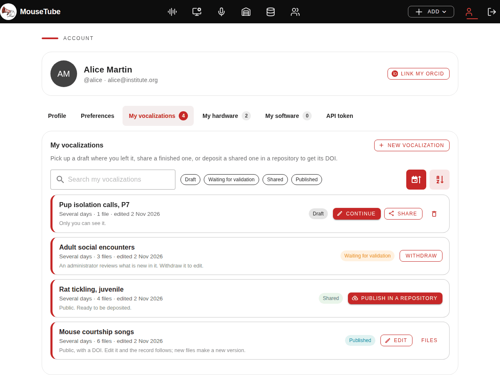
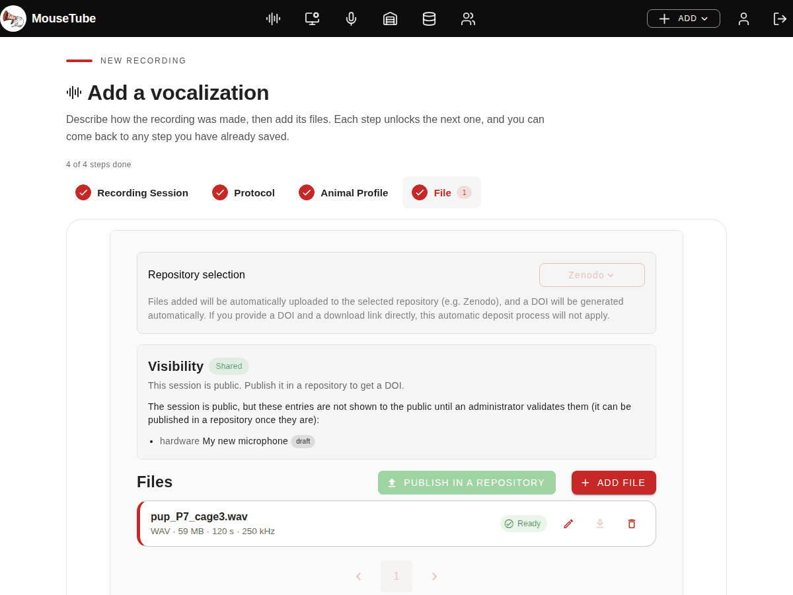

# Share and validation

A session starts as a **draft**: only you can see it, with its files. Sharing it makes it, and its files,
**public**.

<figure markdown>
  
  <figcaption>Your sessions in <strong>Account → My vocalizations</strong>, each in its state.</figcaption>
</figure>

## The four states of a session

| State | Who sees it | What you can do |
|---|---|---|
| Draft | Only you | Continue editing, **Share**, delete |
| Waiting for validation | Only you (and the administrators) | **Withdraw** to edit again. You cannot edit it meanwhile. |
| Shared | Everybody | Edit it (it stays public), **Publish in a repository** to get a DOI |
| Published | Everybody, with a DOI | Edit it (its record follows), add files for a new version |

## Share a session

Open the last step (**File**) and choose **Share this session** in the *Visibility* card, or use **Share** in
*My vocalizations*. There are two cases.

### Everything you use is already validated

The session becomes **Shared** at once and is public.

### You use something new

If the session uses an entry nobody validated yet (a microphone you created, a new animal profile…), it goes
to **Waiting for validation**. It stays private. An administrator is told, reads what is new, and validates it.

<figure markdown>
  
  <figcaption>The Visibility card lists the entries an administrator still has to validate.</figcaption>
</figure>

- When the administrator validates the session **and** what it uses, it becomes **Shared** and you receive an
  e-mail.
- The administrator can also **send it back to draft** with a reason, which you receive by e-mail.
- You can **Withdraw** a session that waits, to change it, then share it again.

## After sharing

You keep **editing** a shared or published session; it stays public. What it uses and nobody validated yet
(for example an equipment you added afterwards) is simply **not shown to the others** until it is validated.
You and the administrators always see everything.

!!! warning "What you cannot do"
    - You cannot **unshare** a session, nor **delete** it, once it is shared: it is public. Ask an
      administrator if there is a good reason.
    - A **validated** entry (a laboratory, a strain, a piece of equipment…) is locked: it is shared by many
      people. To fix it, ask an administrator.
    - A session cannot be deposited in a repository while it uses something nobody validated.

## Entries you create

Everything you create (equipment, software, laboratory, strain, animal profile…) is a **draft**, private to you.
You can ask for a review (**waiting validation**) to make it available to everybody once an administrator
validates it. Two exceptions: a **protocol** is validated automatically (it has no free text), and a **study**
is never reviewed (it is private to you).

The exact rights, state by state, are in the [developer documentation](../dev/rights.md).
